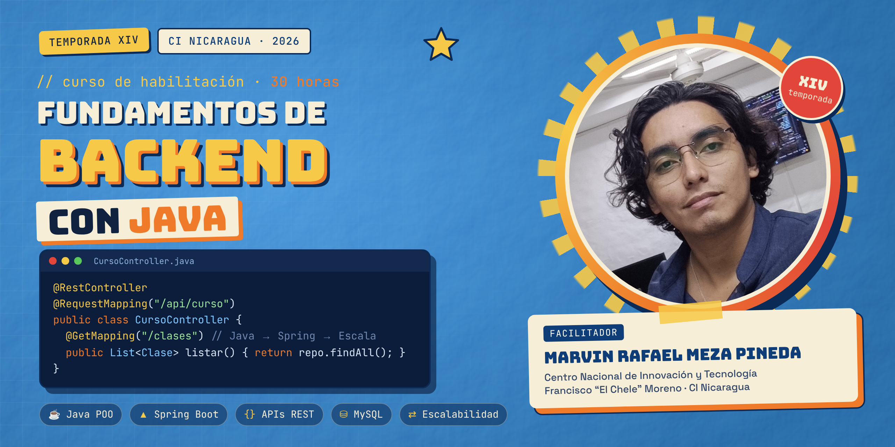

<div align="center">



# ☕ Fundamentos de Desarrollo Backend con Java

**Temporada XIV · CI Nicaragua · 2026**


</div>

---

## 📌 Sobre el curso

Repositorio oficial del curso **Fundamentos de Desarrollo Backend con Java**, impartido en el
**Centro Nacional de Innovación y Tecnología Francisco "El Chele" Moreno (CI Nicaragua)**.

Aquí se publica el código de **cada clase**, con su historial de cambios, para que puedas repasar,
comparar tu trabajo y avanzar a tu ritmo.

> 🎯 **Competencia general:** Desarrollar aplicaciones web haciendo uso de frameworks para backend.

---

## 🗓️ Calendario de encuentros

**Martes y jueves · 6 semanas · del 13 de octubre al 19 de noviembre de 2026**

| Semana | Clase | Fecha | Unidad | Tema |
|:---:|:---:|:---|:---:|:---|
| 1 | 01 | Mar 13 oct | I | Configuración del entorno de desarrollo · Tipos de datos y variables |
| 1 | 02 | Jue 15 oct | I | Estructuras de control en Java |
| 2 | 03 | Mar 20 oct | I | Programación orientada a objetos |
| 2 | 04 | Jue 22 oct | I | Encapsulamiento, herencia y polimorfismo |
| 3 | 05 | Mar 27 oct | II | Introducción a Spring Framework |
| 3 | 06 | Jue 29 oct | II | APIs RESTful |
| 4 | 07 | Mar 3 nov | II | Conexión y configuración de bases de datos |
| 4 | 08 | Jue 5 nov | II | Pruebas y depuración en el desarrollo backend |
| 5 | 09 | Mar 10 nov | III | Optimización de consultas y de bases de datos |
| 5 | 10 | Jue 12 nov | III | Caching de datos |
| 6 | 11 | Mar 17 nov | III | Escalabilidad horizontal y vertical · Balanceo de carga y clustering |
| 6 | 12 | Jue 19 nov | — | 🏁 Proyecto final y cierre |

---

## 🧭 Ruta de aprendizaje

```
 Unidad I                    Unidad II                     Unidad III
 Fundamentos de Java   ──▶   Desarrollo Backend      ──▶   Optimización y
 POO · Control · Datos       Spring · REST · BD · Tests    escalabilidad
```

<details>
<summary><b>Unidad I · Fundamentos de Java</b></summary>

- Configuración del entorno de desarrollo de Java
- Tipos de datos y variables
- Estructuras de control
- Programación orientada a objetos
- Encapsulamiento, herencia y polimorfismo

</details>

<details>
<summary><b>Unidad II · Desarrollo Backend con Java</b></summary>

- Spring Framework
- APIs RESTful
- Conexión y configuración de bases de datos
- Pruebas y depuración

</details>

<details>
<summary><b>Unidad III · Optimización y escalabilidad</b></summary>

- Optimización de consultas y de bases de datos
- Caching de datos
- Escalabilidad horizontal y vertical
- Balanceo de carga y clustering

</details>

---

## 📂 Estructura del repositorio

```
📦 curso-backend-java
 ┣ 📂 assets/          → imágenes y recursos del README
 ┣ 📂 clase-01/        → código y notas de cada encuentro
 ┣ 📂 clase-02/
 ┣ 📂 ...
 ┣ 📂 proyecto-final/
 ┗ 📜 README.md
```

Cada carpeta `clase-XX` incluye su propio `README.md` con los objetivos de la clase, el código
trabajado y los ejercicios propuestos.

---

## 🛠️ Herramientas

| Herramienta | Uso |
|---|---|
| [JDK 17 o superior](https://adoptium.net/) | Compilar y ejecutar Java |
| [Visual Studio Code](https://code.visualstudio.com/) + [Extension Pack for Java](https://marketplace.visualstudio.com/items?itemName=vscjava.vscode-java-pack) | Editor de código |
| [MySQL Workbench](https://dev.mysql.com/downloads/workbench/) | Base de datos |
| [Git](https://git-scm.com/) | Control de versiones |

---

## 🚀 Cómo usar este repositorio

```bash
# 1. Clona el repositorio
git clone <URL-de-este-repositorio>

# 2. Entra a la carpeta
cd curso-backend-java

# 3. Antes de cada clase, trae los cambios nuevos
git pull
```

---

## ✅ Requisitos

- 3er año aprobado
- 14 años cumplidos
- Conocimientos básicos en programación

---

<div align="center">

## 👨‍🏫 Facilitador

**Marvin Rafael Meza Pineda**<br>
Centro Nacional de Innovación y Tecnología Francisco "El Chele" Moreno · CI Nicaragua

<sub>Hecho con ☕ y mucho `System.out.println()` · Temporada XIV · 2026</sub>

</div>
